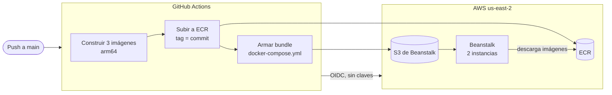

# Despliegue de la aplicación en AWS

Cómo pasa el código de GitHub a `https://itsc.dryvn.org`: conexión del repositorio con la cuenta, construcción de las imágenes, base de datos, despliegue en Beanstalk y envío de correos.

La infraestructura base ya existe (ver [DESPLIEGUE-ITSC.md](DESPLIEGUE-ITSC.md), pasos 0 a 9). Este documento cubre lo que falta para que la aplicación funcione.

> **Actualización 14/11/2026:** la conexión con GitHub por OIDC y GitHub Actions (opciones A y B de este documento) quedó **descartada**: la SCP administrada por AWS niega `iam:*Provider*` y no se puede modificar. El CI/CD ahora es CodePipeline + CodeBuild arm64 dentro de la cuenta, sin credenciales en GitHub. Ver [DESPLIEGUE-ITSC.md, fase 6](DESPLIEGUE-ITSC.md#fase-6-cicd-con-codepipeline-️). El compose de producción vive en `deploy/eb/docker-compose.yml`. Las secciones de base de datos, correos y cambios de código siguen vigentes.

## 1. Cómo funciona el despliegue



1. Cada push a `main` dispara un workflow.
2. El workflow construye las 3 imágenes (backend, finance, frontend) **para arm64**, porque las instancias son t4g (Graviton). Los runners arm64 de GitHub son gratuitos en repositorios públicos desde agosto de 2025 ([GitHub changelog](https://github.blog/changelog/2025-08-07-arm64-hosted-runners-for-public-repositories-are-now-generally-available/)), así que no hace falta emular.
3. Las sube a ECR con el hash del commit como tag. Los repositorios tienen tags inmutables, así que cada versión queda identificada y no se pisa.
4. Arma un zip con el `docker-compose.yml` de producción, que apunta a esas imágenes, y lo registra como nueva versión de la aplicación en Beanstalk.
5. Beanstalk la despliega de a una instancia por vez (`RollingWithAdditionalBatch`), sin perder capacidad. Las instancias descargan las imágenes de ECR con su propio rol: Beanstalk se autentica solo ([AWS](https://docs.aws.amazon.com/elasticbeanstalk/latest/dg/docker-configuration.remote-repo.html)).

Volver a una versión anterior es volver a desplegar una versión ya registrada en Beanstalk.

## 2. Conectar el repositorio con la cuenta

### Opción A: OIDC (recomendada)

GitHub Actions pide credenciales temporales a AWS en cada ejecución. **No se guarda ninguna clave en GitHub.** El rol solo lo puede asumir un workflow de la rama `main` de `sergioortiz17/AcademiaDigital`.

Ya está escrito en Terraform (pasos 14 y 15 de [DESPLIEGUE-ITSC.md](DESPLIEGUE-ITSC.md)):

| Unidad | Qué crea |
|---|---|
| `shared/github-oidc-provider` | El proveedor OIDC de GitHub en la cuenta (uno por cuenta) |
| `itsc/github-oidc` | El rol `academiadigital-itsc-prod-github-actions`, con permisos para subir a ECR, desplegar en Beanstalk y encender o apagar a demanda |

**Bloqueo probable:** la política de la organización niega `iam:ListOpenIDConnectProviders`. Es posible que también niegue crearlos. Hay que intentar el paso 14; si falla con `explicit deny in a service control policy`, la opción A depende de que Gabriel habilite la acción o cree el proveedor desde la cuenta de administración.

Si el paso 15 funciona, en GitHub → **Settings → Secrets and variables → Actions → Variables** se cargan dos **variables** (no secretos, porque no son sensibles):

| Variable | Valor |
|---|---|
| `AWS_ROLE_ARN` | Salida `role_arn` de `itsc/github-oidc` |
| `AWS_REGION` | `us-east-2` |

### Opción B: si la organización no permite OIDC

| Alternativa | Cómo | Contra |
|---|---|---|
| **B1. Usuario IAM con claves en GitHub Secrets** | Un usuario IAM con los mismos permisos del rol; sus claves se guardan como secretos de GitHub | Claves permanentes: hay que rotarlas. La organización también podría bloquear crear usuarios o claves |
| **B2. Desplegar desde la máquina local** | Un script corre los mismos pasos que el workflow con la sesión de `aws login` | El despliegue depende de una persona y de su máquina. Construir arm64 en una laptop x86 requiere emulación (lento) |
| **B3. Imágenes en GitHub, despliegue local** | GitHub construye las imágenes arm64 y las publica en GitHub Container Registry; el despliegue en Beanstalk se lanza desde la máquina local | Las imágenes quedan públicas (el código ya lo es). Sigue dependiendo de la máquina local para desplegar |

Recomendación: intentar la A. Si falla, pedirle a Gabriel el proveedor OIDC; mientras tanto, usar la B2 para no frenar.

## 3. ¿Hay que crear la RDS? Sí

La aplicación no funciona sin base de datos: el backend y Finance aplican sus migraciones al arrancar y se caen si no hay base.

| Orden | Paso de [DESPLIEGUE-ITSC.md](DESPLIEGUE-ITSC.md) | Por qué en este orden |
|---|---|---|
| 1 | Paso 10: `itsc/database` | Crea la RDS. Tarda entre 10 y 20 minutos |
| 2 | Paso 11: `itsc/secrets` | Arma las connection strings con la dirección de la RDS y las guarda en Parameter Store |
| 3 | Paso 12: `itsc/app` | Beanstalk lee esos secretos al arrancar cada instancia |
| 4 | Paso 13: `itsc/schedule` | Horario de servicio |
| 5 | Pasos 14 y 15: CI | Conexión de GitHub |
| 6 | Primer despliegue | Workflow o script |

El backend crea su esquema en la base `academiadigital`. Finance crea su propia base, `academiadigital_finance`, en la misma instancia la primera vez que arranca. Después del primer despliegue hay que cargar los datos iniciales (carreras, plan de estudios, usuario admin) con los scripts de [seeds/](../seeds/README.md). Para eso hay que acceder a la RDS, que está en una subnet privada: se hace desde una instancia de la app con Session Manager. Lo detallo cuando lleguemos.

**Costo:** desde que se crean la RDS y Beanstalk, el gasto pasa a unos 51 USD por mes con el horario de servicio (ver [README](README.md#costo-estimado)).

## 4. El `docker-compose.yml` de producción

Es el archivo que Beanstalk ejecuta en cada instancia. Diferencias con el de desarrollo:

- Usa las **imágenes de ECR** en lugar de `build:`. El workflow escribe el tag del commit antes de armar el zip.
- **No tiene base de datos:** la base es RDS.
- **No tiene dev-tools**, y `ALLOW_TIME_TRAVEL` queda en `false`.
- El frontend publica el **puerto 80** de la instancia, que es a donde envía el tráfico el ALB. Con Docker Compose, Beanstalk no pone su propio nginx delante ([AWS](https://docs.aws.amazon.com/elasticbeanstalk/latest/dg/create_deploy_docker.container.console.html)).
- Los nombres de servicio tienen que coincidir con los que usan las aplicaciones: el nginx del frontend envía `/api/` a `backend:8000`, y Finance llama a `backend:8000`.

### Cómo llegan los secretos a cada contenedor

Beanstalk escribe todas las variables del entorno (incluidos los secretos de Parameter Store) en un archivo `.env` junto al `docker-compose.yml`. Cada servicio lo carga con `env_file: .env` ([AWS](https://docs.aws.amazon.com/elasticbeanstalk/latest/dg/create_deploy_docker.container.console.html)).

Hay un problema: el backend y Finance leen la misma clave, `ConnectionStrings__DefaultConnection`, pero con valores distintos, y el `.env` es uno solo. Por eso los secretos tienen nombres propios (`BACKEND_DB_CONNECTION`, `FINANCE_DB_CONNECTION`, `JWT_SECRET_KEY`) y cada contenedor los traduce al arrancar:

```yaml
services:
  backend:
    image: 740227232235.dkr.ecr.us-east-2.amazonaws.com/academiadigital/backend:<commit>
    env_file: .env
    entrypoint:
      - /bin/sh
      - -c
      - >-
        export ConnectionStrings__DefaultConnection="$$BACKEND_DB_CONNECTION"
        Jwt__SecretKey="$$JWT_SECRET_KEY"
        Finance__BaseUrl=http://finance:8091
        Cors__AllowedOrigins__0="$$APP_PUBLIC_URL";
        exec dotnet AcademiaDigital.API.dll
```

`$$` evita que Docker Compose intente reemplazar la variable: el valor lo resuelve el shell del contenedor al arrancar. Se hace así porque Beanstalk escapa los `$` del `.env` y la interpolación de Compose necesitaría un hook extra ([AWS](https://docs.aws.amazon.com/elasticbeanstalk/latest/dg/create_deploy_docker.container.console.html)).

## 5. Correos de recuperación de contraseña

### Lo que ya está

| Pieza | Estado |
|---|---|
| Dominio `itsc.dryvn.org` verificado en SES (us-east-2) | ✅ DKIM, MAIL FROM, SPF y DMARC en `SUCCESS` |
| Permiso de las instancias para enviar (`ses:SendEmail`) | ✅ En el rol de Beanstalk |
| Variables `MAIL_FROM` (`no-reply@itsc.dryvn.org`) y `APP_PUBLIC_URL` | ✅ En el entorno de Beanstalk |

### Lo que falta en el código

Hoy el flujo funciona así: el usuario carga su email, el backend **devuelve el token en la respuesta** ([AuthController.cs:82](../backend-dotnet/src/AcademiaDigital.API/Controllers/AuthController.cs#L82)) y el frontend muestra en la misma pantalla el formulario de contraseña nueva ([forgot-password.component.ts:89](../frontend-angular/src/app/features/auth/forgot-password/forgot-password.component.ts#L89)). Con el sistema público, cualquiera que conozca el email de otra persona puede cambiarle la contraseña.

Cambios necesarios:

| # | Dónde | Cambio |
|---|---|---|
| 1 | Backend, Application | Interfaz `IEmailSender` |
| 2 | Backend, Infrastructure | `SesEmailSender` con el SDK de SES v2 (`AWSSDK.SimpleEmailV2`). Usa el rol de la instancia: sin claves ni usuario SMTP |
| 3 | `ForgotPasswordUseCase` | Enviar un correo con el enlace `https://itsc.dryvn.org/auth/reset-password?token=...` |
| 4 | `AuthController` | **Dejar de devolver `resetToken`**. Responder siempre el mismo mensaje, exista o no el email |
| 5 | Frontend | Pantalla nueva `/auth/reset-password` que lee el token del enlace y pide la contraseña nueva |
| 6 | Frontend | `forgot-password` queda solo con el email y el mensaje "si el correo está registrado, vas a recibir un enlace" |
| 7 | Desarrollo local | Implementación alternativa que escribe el enlace en el log, para probar sin SES |

### Sandbox de SES

La cuenta está en el sandbox: **200 correos por día y solo a direcciones verificadas**. Con eso alcanza para probar con tu correo, pero no para alumnos reales. Para producción hay que pedir el acceso desde **SES → Account dashboard → Request production access** en us-east-2. AWS pide describir el uso (correos transaccionales de recuperación de contraseña), cómo se manejan rebotes y quejas, y el volumen esperado. Según un documento de AWS suele responder en 24 horas ([AWS](https://media.amazonwebservices.com/AWS_Service_Amazon_SES.pdf)); otras fuentes hablan de 1 a 3 días hábiles ([SaaS Price Pulse](https://www.saaspricepulse.com/tools/amazon-ses)). El sandbox es por región: el pedido tiene que ser para us-east-2.

## 6. Otros cambios de código antes de producción

| Cambio | Por qué | Urgencia |
|---|---|---|
| `IFileStorage` sobre S3 (backend y Finance) | Hoy los documentos subidos se guardan en el disco de la instancia: con 2 instancias, un archivo existe en una sola, y se pierde cuando Beanstalk reemplaza la instancia | **Antes de producción** |
| Correo por SES | Ver sección 5 | **Antes de producción** |
| Endpoint `/health` | El ALB hoy revisa `/`, que solo prueba el nginx del frontend. Si el backend se cae, el ALB no se entera | Recomendado |
| Programar `outbox/process` y `process-expirations` | Hoy nadie los invoca | Recomendado |
| Migraciones fuera del arranque | Con despliegues de a una instancia el riesgo es bajo, pero si las 2 instancias arrancan juntas a las 07:00 con migraciones pendientes, compiten | Recomendado |

## 7. Qué necesito de ti

| # | Qué | Para qué |
|---|---|---|
| 1 | Confirmación de Gabriel de que la producción del ITSC puede vivir en la cuenta 740227232235 | Antes de crear la RDS (paso 10) |
| 2 | Que Gabriel habilite o cree el proveedor OIDC de GitHub, si el paso 14 falla | Opción A de la sección 2 |
| 3 | Permiso de administración del repositorio `sergioortiz17/AcademiaDigital` | Cargar las variables de GitHub Actions |
| 4 | Pedir el acceso a producción de SES | Correos a cualquier alumno |
| 5 | Confirmar el correo de verificación de AWS Budgets | Recibir las alertas de gasto |
| 6 | Qué datos iniciales cargar en producción: ¿los seeds de demo o datos reales del ITSC? | Primer arranque |

## 8. Archivos que faltan crear

| Archivo | Qué hace |
|---|---|
| `deploy/eb/docker-compose.yml` | Compose de producción (sección 4) |
| `.github/workflows/deploy.yml` | Construye, sube a ECR y despliega en Beanstalk |
| `.github/workflows/power-on.yml` y `power-off.yml` | Encender fuera de horario y apagar ahora |
| `infra/scripts/deploy-local.sh` | Opción B2: el mismo despliegue desde la máquina local |
| Cambios de la sección 5 | Correo por SES y pantalla de restablecer contraseña |
| Cambios de la sección 6 | S3, `/health` y tareas programadas |
