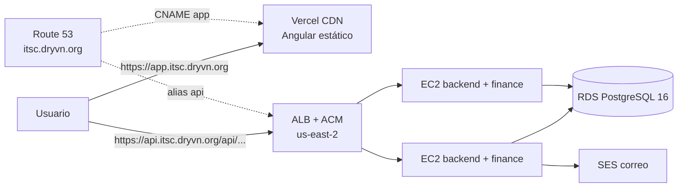

# Frontend en Vercel y backend en AWS

Guía para servir el frontend Angular desde Vercel y el backend (.NET + Finance) desde Elastic Beanstalk con RDS PostgreSQL, en la cuenta `740227232235` (us-east-2).

Complementa a [DESPLIEGUE-ITSC.md](DESPLIEGUE-ITSC.md) (infraestructura) y [DESPLIEGUE-APLICACION.md](DESPLIEGUE-APLICACION.md) (imágenes y despliegue del backend). Lo que cambia respecto de esos documentos está marcado con **[cambia]**.

---

## 0. Respuesta corta

| Pregunta | Respuesta |
|---|---|
| ¿Es posible? | Sí. El frontend es una SPA estática y el backend autentica con JWT en el header `Authorization` (no usa cookies), así que pueden vivir en dominios distintos solo con CORS. |
| ¿Hay que separar el repositorio? | **No.** Vercel permite desplegar una subcarpeta de un monorepo con la opción **Root Directory** ([docs](https://vercel.com/docs/monorepos)). Se apunta a `frontend-angular/` y listo. |
| ¿Hay que crear la RDS? | Sí, igual que antes. El backend sigue en AWS y necesita PostgreSQL. |
| ¿Qué desaparece? | El contenedor `frontend` (nginx) de Beanstalk. El repositorio ECR `academiadigital/frontend` queda sin uso. |

### Por qué no separar el repositorio

| Monorepo (recomendado) | Repos separados |
|---|---|
| Un PR puede cambiar API y frontend juntos, sin coordinar versiones. | Cada cambio de contrato de API requiere dos PRs sincronizados. |
| El historial de la tesis queda en un solo lugar. | Hay que partir el historial (`git filter-repo`) y reconfigurar el equipo de front. |
| Vercel solo reconstruye cuando cambia `frontend-angular/` (sección 4.3). | Aislamiento total de permisos, que hoy no hace falta. |

Separar tiene sentido recién si los equipos de front y back necesitan permisos o ciclos de release distintos.

---

## 1. Arquitectura resultante



- El navegador descarga el frontend de Vercel y llama directo a la API en AWS. Vercel **no** hace de proxy.
- No uso los `rewrites` de Vercel hacia la API: agregan un salto más y el backend vería las IPs de Vercel en lugar de la del alumno, lo que rompe el rate limiter de admisiones (`Program.cs:225`, particiona por IP).

### Dominios

| Host | Destino | Por qué |
|---|---|---|
| `app.itsc.dryvn.org` | Vercel | `itsc.dryvn.org` es el **apex de la zona de Route 53**, y en el apex no se puede crear un CNAME ([Route 53](https://docs.aws.amazon.com/Route53/latest/DeveloperGuide/ResourceRecordTypes.html#CNAMEFormat)). Vercel configura los subdominios con CNAME ([Vercel](https://vercel.com/docs/domains/working-with-domains/add-a-domain#subdomains)). Con `app.` funciona seguro. |
| `api.itsc.dryvn.org` | ALB de Beanstalk | Registro alias, como ya estaba, pero en el subdominio. |
| `itsc.dryvn.org` | Sin uso por ahora | Sigue siendo la identidad de SES (`no-reply@itsc.dryvn.org`), eso no cambia. |

> **Decisión tuya:** si prefieres otros nombres (`campus.`, `www.`), cámbialos en el paso 3.1. Todo lo demás se deriva de ahí.

---

## 2. Antes de empezar: el plan de Vercel

**Problema serio:** los términos de Vercel dicen que el plan Hobby (gratuito) es solo para uso personal o no comercial ("You shall only use the Services under a Hobby plan for your personal or non-commercial use", [Terms, sección 4](https://vercel.com/legal/terms)). Una plataforma en producción para una institución difícilmente califica. Vercel no define "comercial" en ese texto, así que si hay duda, hay que consultarles.

| Opción | Costo | Comentario |
|---|---|---|
| Vercel Pro | 20 USD por usuario desarrollador por mes ([Vercel](https://vercel.com/docs/plans/hobby#upgrading-to-pro)) | Cumple los términos. La cuenta debería ser de la institución, no personal. |
| Vercel Hobby | 0 USD | Riesgo de incumplir los términos y que pausen el proyecto. Aceptable solo para la demo de la tesis. |
| S3 + CloudFront en la misma cuenta AWS | Bajo, y entra en el presupuesto de 100 USD | Todo en Terraform y en una sola factura. Si te interesa, armo el módulo. |

**Quién es dueño de la cuenta de Vercel:** igual que la cuenta AWS, debería estar a nombre de la institución (o de un correo institucional), no del correo personal de un alumno.

---

## 3. Cambios en el repositorio

Ninguno está hecho todavía. Los marco con quién los hace.

### 3.1 Infraestructura (Terragrunt) — **[cambia]**, lo hago yo si me confirmas

| Archivo | Cambio |
|---|---|
| `/home/sergio/Videos/ITSC/3erAnio/TESIS/AcademiaDigital/infra/live/itsc/scope.hcl` | Agregar `frontend_domain = "app.itsc.dryvn.org"` y `api_domain = "api.itsc.dryvn.org"`. |
| `/home/sergio/Videos/ITSC/3erAnio/TESIS/AcademiaDigital/infra/live/itsc/certificate/terragrunt.hcl` | `domain_name = local.scope.api_domain`. El certificado de `itsc.dryvn.org` se **reemplaza** (todavía no lo usa ningún ALB, no afecta nada). |
| `/home/sergio/Videos/ITSC/3erAnio/TESIS/AcademiaDigital/infra/live/itsc/app/terragrunt.hcl` | `domain_name = local.scope.api_domain` (registro alias), `APP_PUBLIC_URL = "https://${local.scope.frontend_domain}"`, `health_check_path = "/health"`. `MAIL_FROM` queda igual. |
| `/home/sergio/Videos/ITSC/3erAnio/TESIS/AcademiaDigital/infra/live/itsc/frontend-dns/terragrunt.hcl` (nuevo) | Unidad con un `aws_route53_record` CNAME `app` hacia el valor que da Vercel (paso 4.4). Depende de `dns-zone`. |

`APP_PUBLIC_URL` se usa para dos cosas: el origen permitido por CORS y los enlaces de recuperación de contraseña. Por eso tiene que ser la URL del **frontend**.

### 3.2 Backend — lo hago yo si me confirmas

1. **Endpoint `/health`** en `/home/sergio/Videos/ITSC/3erAnio/TESIS/AcademiaDigital/backend-dotnet/src/AcademiaDigital.API/Program.cs`. Hoy el health check del ALB pega en `/`, que antes respondía nginx del frontend. Sin el frontend, `/` devolvería 404 y Beanstalk marcaría las instancias como no saludables.
   ```csharp
   app.MapGet("/health", () => Results.Ok(new { status = "ok" })).AllowAnonymous();
   ```
2. **Forwarded headers** detrás del ALB, para que `RemoteIpAddress` sea la IP real del usuario (el comentario de `Program.cs:218` ya lo pide). Se limpian `KnownNetworks`/`KnownProxies` porque la IP del ALB cambia; es seguro porque las instancias solo aceptan tráfico del security group del ALB.
   ```csharp
   builder.Services.Configure<ForwardedHeadersOptions>(o =>
   {
       o.ForwardedHeaders = ForwardedHeaders.XForwardedFor | ForwardedHeaders.XForwardedProto;
       o.KnownNetworks.Clear();
       o.KnownProxies.Clear();
   });
   // ...
   app.UseForwardedHeaders(); // antes de UseCors y UseRateLimiter
   ```
   Referencia: [ASP.NET Core detrás de un proxy o balanceador](https://learn.microsoft.com/aspnet/core/host-and-deploy/proxy-load-balancer).
3. Los cambios de correo de recuperación de [DESPLIEGUE-APLICACION.md, sección 5](DESPLIEGUE-APLICACION.md) siguen pendientes y no cambian.

### 3.3 Compose de producción del backend — **[cambia]**

`/home/sergio/Videos/ITSC/3erAnio/TESIS/AcademiaDigital/deploy/eb/docker-compose.yml` ya no lleva el servicio `frontend`. El backend publica directo en el puerto 80 de la instancia, que es donde el ALB envía el tráfico:

```yaml
services:
  backend:
    image: 740227232235.dkr.ecr.us-east-2.amazonaws.com/academiadigital/backend:<commit>
    env_file: .env
    ports:
      - "80:8000"
    entrypoint: [/bin/sh, -c, "export ConnectionStrings__DefaultConnection=\"$$BACKEND_DB_CONNECTION\" Jwt__SecretKey=\"$$JWT_SECRET_KEY\" Finance__BaseUrl=http://finance:8091 Cors__AllowedOrigins__0=\"$$APP_PUBLIC_URL\"; exec dotnet AcademiaDigital.API.dll"]
  finance:
    image: 740227232235.dkr.ecr.us-east-2.amazonaws.com/academiadigital/finance:<commit>
    env_file: .env
    # sin ports: solo lo usa el backend por la red interna de compose
```

### 3.4 Frontend — lo hago yo si me confirmas

1. `/home/sergio/Videos/ITSC/3erAnio/TESIS/AcademiaDigital/frontend-angular/src/environments/environment.prod.ts`:
   ```ts
   export const environment = {
     production: true,
     apiServer: 'https://api.itsc.dryvn.org/api/'
   };
   ```
   `environment.ts` (desarrollo) queda en `'/api/'` con el `proxy.conf.json` de siempre. El Docker local también sigue funcionando porque usa nginx.
2. `/home/sergio/Videos/ITSC/3erAnio/TESIS/AcademiaDigital/frontend-angular/vercel.json` (nuevo):
   ```json
   {
     "installCommand": "npm ci --legacy-peer-deps",
     "buildCommand": "npm run build -- --configuration=production",
     "outputDirectory": "dist/frontend-angular/browser",
     "rewrites": [{ "source": "/(.*)", "destination": "/index.html" }]
   }
   ```
   - `--legacy-peer-deps`: el `package-lock.json` tiene `@angular/animations` desalineado con `@angular/core`; sin esto `npm ci` falla con `ERESOLVE` (el Dockerfile ya lo usa).
   - `rewrites`: Vercel sirve primero los archivos que existen y, si la ruta no existe (por ejemplo `/auth/signin` al recargar), devuelve `index.html` para que la resuelva el router de Angular ([Vercel rewrites](https://vercel.com/docs/rewrites)).
3. **Apagado nocturno:** Vercel está siempre encendido, pero el backend se apaga de 22 a 7 y los domingos. De noche el alumno verá el login, pero fallará al entrar. Conviene que el interceptor muestre "La plataforma está fuera de horario (lunes a viernes 7–22, sábados 7–13)" cuando la API no responde.

---

## 4. Configurar Vercel

### 4.1 Importar el proyecto

1. En [vercel.com](https://vercel.com), **Add New → Project** → importar `sergioortiz17/AcademiaDigital` (autorizar la app de GitHub para ese repo solamente).
2. **Root Directory:** `frontend-angular` ([docs](https://vercel.com/docs/monorepos#add-a-monorepo-through-the-vercel-dashboard)).
3. **Framework Preset:** Angular. Los comandos de build salen del `vercel.json`.
4. **Production Branch:** `main`. Cada PR genera un preview con URL propia.

### 4.2 Versión de Node

En **Settings → Build and Deployment → Node.js Version**, elegir **22.x**. Angular 21 requiere Node 20.19 o superior ([tabla de compatibilidad](https://angular.dev/reference/versions)).

### 4.3 Construir solo cuando cambia el frontend

El salteo automático de Vercel exige workspaces de npm, que este repo no usa ([docs](https://vercel.com/docs/monorepos#requirements)). En su lugar, en **Settings → Git → Ignored Build Step**, usar:

```bash
git diff --quiet HEAD^ HEAD -- .
```

Si no hubo cambios en `frontend-angular/`, el comando sale con código 0 y Vercel cancela el build ([guía](https://vercel.com/kb/guide/how-do-i-use-the-ignored-build-step-field-on-vercel)).

### 4.4 Dominio

1. **Settings → Domains → Add** → `app.itsc.dryvn.org`.
2. Vercel muestra un **CNAME** propio del proyecto (del estilo `xxxx.vercel-dns-0xx.com`). Copiarlo **tal cual**: es único por proyecto.
3. Pasarme ese valor y lo pongo en la unidad `frontend-dns` (paso 5.2). No lo cargues a mano en la consola de Route 53: la zona la maneja Terraform.
4. Si Vercel pide además un registro **TXT** `_vercel` de verificación, también lo agrego a la unidad.
5. Cuando el DNS propaga, Vercel emite el certificado HTTPS solo.

### 4.5 Previews

Las URLs de preview (`*.vercel.app`) **no** van a poder llamar a la API de producción porque CORS solo permite `https://app.itsc.dryvn.org`. Es intencional: no conviene que un preview de un PR escriba en la base de producción.

---

## 5. Orden de ejecución

Cada paso con `plan` primero y `apply` después, igual que en [DESPLIEGUE-ITSC.md](DESPLIEGUE-ITSC.md). Antes de cada apply largo: `aws login` y `ad-whoami` (debe decir `740227232235`).

| # | Qué | Dónde | Resultado esperado del plan |
|---|---|---|---|
| 1 | Cambios de código e infra de la sección 3 | Yo, en una rama nueva | — |
| 2 | Certificado de `api.` | `cd /home/sergio/Videos/ITSC/3erAnio/TESIS/AcademiaDigital/infra/live/itsc/certificate && terragrunt plan` | Certificado **reemplazado**, registro de validación nuevo y el viejo destruido. Nada fuera de ACM y Route 53. |
| 3 | RDS (paso 10 original) | `cd /home/sergio/Videos/ITSC/3erAnio/TESIS/AcademiaDigital/infra/live/itsc/database && terragrunt plan` | 5 para crear. Tarda 10–20 min el apply. |
| 4 | Secretos (paso 11) | `cd /home/sergio/Videos/ITSC/3erAnio/TESIS/AcademiaDigital/infra/live/itsc/secrets && terragrunt plan` | 4 para crear. |
| 5 | Beanstalk (paso 12) | `cd /home/sergio/Videos/ITSC/3erAnio/TESIS/AcademiaDigital/infra/live/itsc/app && terragrunt plan` | 12 para crear; el registro alias es `api.itsc.dryvn.org`. |
| 6 | Horario (paso 13) | `cd /home/sergio/Videos/ITSC/3erAnio/TESIS/AcademiaDigital/infra/live/itsc/schedule && terragrunt plan` | 9 para crear. |
| 7 | Primera versión del backend | Según [DESPLIEGUE-APLICACION.md](DESPLIEGUE-APLICACION.md), con el compose de la sección 3.3 | Entorno en verde en Beanstalk. |
| 8 | Proyecto en Vercel | Sección 4.1 a 4.3 | Deploy OK en la URL `*.vercel.app` (las llamadas a la API fallan por CORS, es esperado). |
| 9 | Dominio en Vercel | Sección 4.4 → me pasas el CNAME | — |
| 10 | DNS del frontend | `cd /home/sergio/Videos/ITSC/3erAnio/TESIS/AcademiaDigital/infra/live/itsc/frontend-dns && terragrunt plan` | 1 para crear (2 si hay TXT). |

El paso 2 puede ir antes de la confirmación de Gabriel porque no genera costo; desde el 3 en adelante sí.

---

## 6. Verificación

```bash
# API viva y con certificado válido
curl -sS https://api.itsc.dryvn.org/health

# CORS: debe devolver access-control-allow-origin: https://app.itsc.dryvn.org
curl -sS -o /dev/null -D - -X OPTIONS https://api.itsc.dryvn.org/api/v1/users/login \
  -H "Origin: https://app.itsc.dryvn.org" \
  -H "Access-Control-Request-Method: POST" | grep -i access-control

# Frontend y recarga en una ruta interna (debe dar 200, no 404)
curl -sS -o /dev/null -w "%{http_code}\n" https://app.itsc.dryvn.org/auth/signin
```

En el navegador: entrar a `https://app.itsc.dryvn.org`, iniciar sesión con cada rol, y revisar en DevTools → Network que las llamadas vayan a `api.itsc.dryvn.org` sin errores de CORS.

---

## 7. Problemas frecuentes

| Síntoma | Causa probable | Solución |
|---|---|---|
| Build de Vercel falla con `ERESOLVE` | Falta `--legacy-peer-deps` | Revisar que `vercel.json` esté dentro de `frontend-angular/`. |
| Build OK pero la página sale en blanco o 404 | `outputDirectory` mal | Debe ser `dist/frontend-angular/browser`. |
| 404 al recargar `/auth/signin` | Falta el `rewrite` a `index.html` | Ver sección 3.4. |
| Error de CORS en el navegador | `APP_PUBLIC_URL` no coincide exactamente con el origen (protocolo, subdominio, sin `/` final) | Corregir en `infra/live/itsc/app/terragrunt.hcl` y aplicar. |
| Beanstalk en rojo tras desplegar | Health check en `/` o `/health` inexistente | Verificar que el backend exponga `/health` y que `health_check_path` sea `/health`. |
| Todos los alumnos reciben 429 en admisiones | El backend ve la IP del ALB | Falta `UseForwardedHeaders` (sección 3.2). |
| Login falla de noche o el domingo | Backend apagado por el horario | Es esperado; encendido a demanda en [DESPLIEGUE-ITSC.md](DESPLIEGUE-ITSC.md). |

---

## 8. Qué necesito de ti

| # | Qué | Para qué |
|---|---|---|
| 1 | Confirmar los nombres `app.` y `api.` (o los que prefieras) | Todo el resto se deriva de eso. |
| 2 | Plan de Vercel y dueño de la cuenta (sección 2) | Evitar incumplir los términos en producción. |
| 3 | Visto bueno para hacer los cambios de la sección 3 | Hoy no hay nada modificado. |
| 4 | El CNAME (y TXT si lo pide) que muestre Vercel en el paso 4.4 | Para la unidad `frontend-dns`. |
| 5 | Confirmación de Gabriel antes del paso 3 de la sección 5 | Es el primer recurso con costo fijo. |
