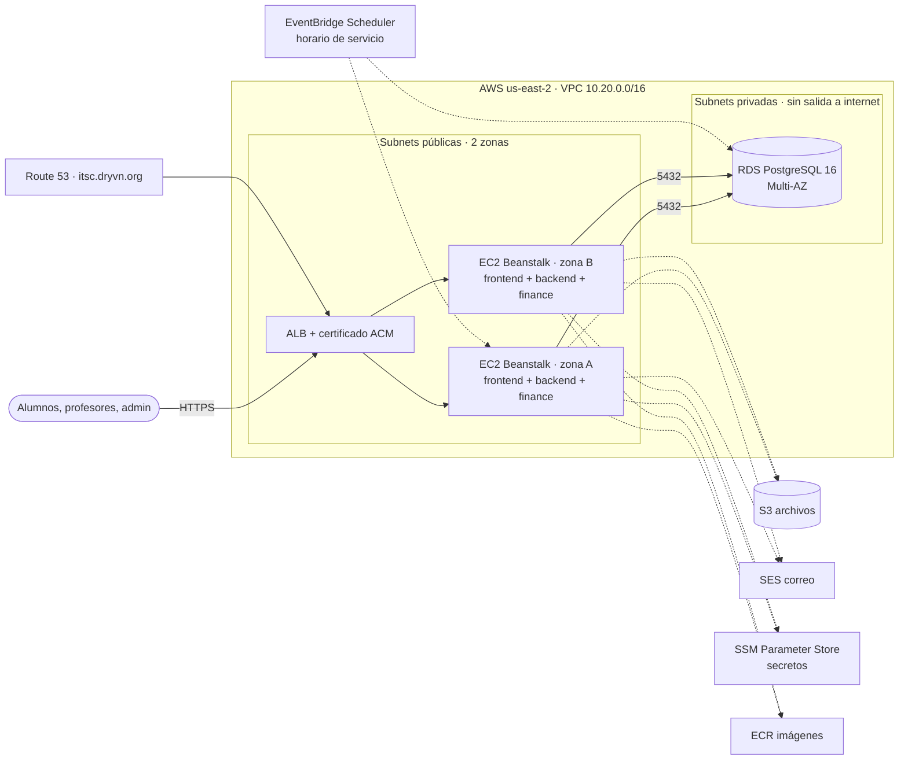
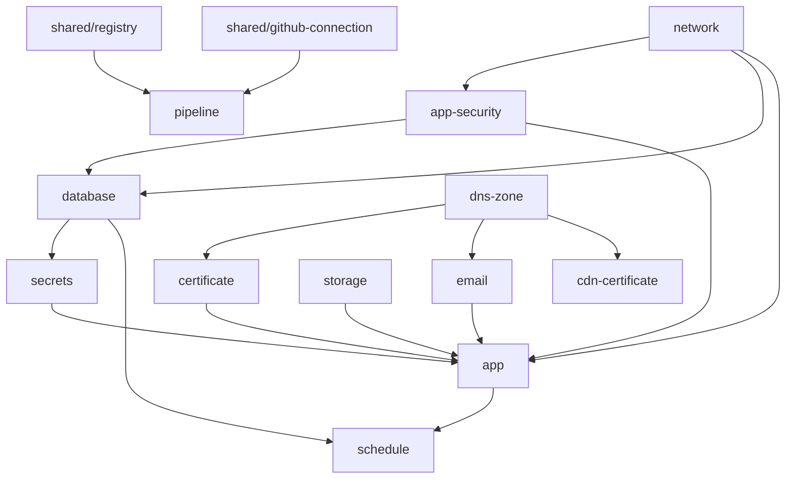

# Infraestructura de AcademiaDigital en AWS

Terragrunt + Terraform para desplegar AcademiaDigital en producción. La primera institución es el ITSC, en `https://itsc.dryvn.org`. La estructura está pensada para sumar otras instituciones, cada una con su propia infraestructura y su propia base de datos.

## Arquitectura



| Pieza | Decisión |
|---|---|
| Región | us-east-2 (Ohio). La cuenta es un proyecto de *Sign up for AWS (new)*: AWS asigna la región por país y sus SCP solo permiten us-east-2, más servicios globales en us-east-1 ([AWS](https://docs.aws.amazon.com/accounts/latest/reference/project-regions.html)) |
| Red | VPC propia, 2 zonas, sin NAT Gateway. Las instancias están en subnets públicas pero solo aceptan tráfico del ALB |
| Cómputo | Elastic Beanstalk, plataforma Docker sobre Amazon Linux 2023, 2 × t4g.small (arm64) detrás de un ALB |
| Base de datos | RDS PostgreSQL 16, db.t4g.micro Multi-AZ, cifrada, backups de 7 días, protección contra borrado |
| HTTPS | Certificado de ACM en el ALB; renovación automática |
| DNS | Hosted zone `itsc.dryvn.org` en Route 53, delegada desde Cloudflare |
| Correo | Amazon SES con DKIM, MAIL FROM, SPF y DMARC |
| Secretos | SSM Parameter Store (SecureString); Beanstalk los inyecta como variables de entorno |
| Imágenes | ECR, una por servicio, con tags inmutables, compartidas entre instituciones |
| CI/CD | CodePipeline + CodeBuild arm64 dentro de la cuenta. Lee GitHub por CodeConnections: GitHub no guarda credenciales de AWS. (OIDC lo bloquea la SCP administrada por AWS) |
| Estado | S3, un estado por unidad, con bloqueo nativo (`use_lockfile`) |

## Estructura

```text
infra/
├── .terraform-version        1.17.1 (tfenv)
├── .terragrunt-version       1.2.1  (tgenv)
├── modules/                  Módulos de Terraform reutilizables (no saben de Terragrunt)
│   ├── network/              VPC, subnets, rutas
│   ├── app-security/         Security group de las instancias
│   ├── dns-zone/             Hosted zone del subdominio
│   ├── certificate/          Certificado ACM validado por DNS
│   ├── email/                Identidad SES y registros de correo
│   ├── storage/              Bucket S3 de archivos de la app
│   ├── database/             RDS PostgreSQL
│   ├── secrets/              Connection strings y JWT en Parameter Store
│   ├── app/                  Elastic Beanstalk (aplicación, entorno, IAM, registro DNS)
│   ├── schedule/             Horario de servicio
│   ├── github-connection/    Conexión con GitHub por CodeConnections (una por cuenta)
│   ├── pipeline/             CodePipeline + CodeBuild arm64 → ECR → Beanstalk
│   ├── registry/             Repositorios ECR
│   └── budget/               Presupuesto y alertas
└── live/                     Lo que está desplegado
    ├── root.hcl              Backend S3, provider y versiones para todas las unidades
    ├── account.hcl           ID de la cuenta y región
    ├── shared/               Recursos únicos por cuenta
    │   ├── scope.hcl
    │   ├── registry/
    │   ├── github-connection/
    │   └── budget/
    └── itsc/                 Una institución
        ├── scope.hcl         Dominio, capacidad, horario, repositorio
        ├── network/  app-security/  dns-zone/  certificate/  cdn-certificate/  email/  storage/
        └── database/  secrets/  app/  schedule/  pipeline/
```

Cada carpeta con `terragrunt.hcl` es una **unidad** con su propio estado: un error al aplicar la app no puede tocar la base de datos ni la red.

### Dependencias entre unidades



El security group de las instancias está en su propia unidad para cortar un ciclo: RDS necesita autorizarlo, y la app necesita los secretos, que dependen de RDS.

## Horario de servicio

| Día | Encendido (hora de Córdoba) |
|---|---|
| Lunes a viernes | 07:00 a 22:00 |
| Sábado | 07:00 a 13:00 |
| Domingo | Apagado |

La base arranca a las 06:40 y se detiene 15 minutos después de la app. Los horarios están en `modules/schedule/variables.tf` (variable `cron`) y usan la zona `America/Argentina/Cordoba`. Con `power_schedule_enabled = false` en `scope.hcl` la institución queda siempre encendida.

Las ventanas de backup y mantenimiento de RDS y la de parches de Beanstalk están en UTC, dentro del horario de encendido (ver `live/itsc/database` y `live/itsc/app`).

## Costo estimado

Precios on-demand de us-east-1 tomados como referencia (no verifiqué los de us-east-2), sin discos ni transferencia de datos:

| Recurso | Siempre encendido | Con el horario |
|---|---|---|
| ALB | ~16 USD | ~16 USD |
| 2 × EC2 t4g.small | ~25 USD | ~12 USD |
| RDS db.t4g.micro Multi-AZ | ~23 USD | ~11 USD |
| IPv4 públicas | ~14 USD | ~11 USD |
| Route 53 | 0,50 USD | 0,50 USD |
| **Total aproximado** | **~80 USD** | **~51 USD** |

Fuentes: [ELB](https://aws.amazon.com/elasticloadbalancing/pricing/), [EC2 t4g.small](https://cloudprice.net/aws/ec2/instances/t4g.small), [RDS db.t4g.micro](https://www.bytebase.com/dbcost/rds/instance/db.t4g.micro/), [IPv4 pública](https://aws.amazon.com/blogs/aws/new-aws-public-ipv4-address-charge-public-ip-insights), [Route 53](https://aws.amazon.com/route53/pricing/). Varios valores salen de agregadores de terceros: confirmar en la [calculadora de AWS](https://calculator.aws/). El presupuesto (`shared/budget`) es de 100 USD por mes: avisa por correo cuando el gasto real llega a 80 USD y a 100 USD, y cuando el pronóstico del mes supera los 100 USD.

## Despliegue

### Requisitos

- Terraform 1.17.1 y Terragrunt 1.2.1 (`tfenv install` y `tgenv install` dentro de `infra/` toman las versiones de los archivos `.terraform-version` y `.terragrunt-version`).
- AWS CLI con un perfil de la cuenta de destino (`export AWS_PROFILE=...`). Las credenciales nunca se escriben en estos archivos.

### Protección contra operar en otra cuenta

En la misma máquina hay credenciales de cuentas de clientes. Tres capas impiden que esta infraestructura se cree o se modifique en una cuenta que no sea la de `live/account.hcl`:

| Capa | Qué hace |
|---|---|
| `scripts/aws-env.sh` | En esa terminal, el CLI no ve `~/.aws` ni Leapp: solo existe el perfil `academiadigital`. Borra cualquier `AWS_ACCESS_KEY_ID` exportado |
| `scripts/assert-account.sh` (desde `root.hcl`) | Antes de crear el bucket del estado o ejecutar Terraform, compara la cuenta activa con la esperada y aborta si no coinciden |
| `allowed_account_ids` en el provider | Terraform se niega a hacer `plan` o `apply` en otra cuenta |

Uso diario:

```bash
source infra/scripts/aws-env.sh
aws login --profile academiadigital   # si la sesión venció
ad-whoami                             # debe mostrar 740227232235
```

### 1. Completar los datos de la cuenta

| Archivo | Qué completar |
|---|---|
| `live/account.hcl` | `aws_account_id`. El provider usa `allowed_account_ids`: con un perfil de otra cuenta, Terraform se niega a operar |

### 2. Zona DNS y bucket del estado

La primera ejecución crea el bucket del estado (`--backend-bootstrap`):

```bash
cd infra/live/itsc/dns-zone
terragrunt apply --backend-bootstrap
terragrunt output name_servers
```

### 3. Delegar el subdominio en Cloudflare

En la zona `dryvn.org` de Cloudflare, crear **4 registros NS** con nombre `itsc`, uno por cada valor de `name_servers` ([Cloudflare: delegar subdominios](https://developers.cloudflare.com/dns/manage-dns-records/how-to/subdomains-outside-cloudflare/)). Verificar:

```bash
dig NS itsc.dryvn.org +short
```

Sin la delegación, la unidad `certificate` queda esperando la validación del certificado.

### 4. Todo lo demás

```bash
cd infra/live
terragrunt run --all plan
terragrunt run --all apply
```

**Revisar siempre el `plan` antes del `apply`:** con `--all`, Terragrunt pide una sola confirmación para todo el stack y después aplica cada unidad con `-auto-approve`. Para confirmar unidad por unidad, usar `terragrunt run --all apply --no-auto-approve`, o aplicar desde la carpeta de una unidad.

Terragrunt aplica las unidades en el orden de sus dependencias. En el primer `plan`, las unidades que dependen de otras todavía no aplicadas usan valores simulados (`mock_outputs`); el `apply` siempre usa los valores reales.

El entorno de Beanstalk arranca con la aplicación de ejemplo de AWS hasta que la CI despliegue la primera versión.

### 5. SES

La cuenta empieza en el sandbox de SES: solo puede enviar a direcciones verificadas. Para producción hay que pedir el acceso desde la consola de SES.

## Sumar una institución

1. Copiar `live/itsc/` a `live/<institución>/`.
2. Cambiar `scope.hcl`: `client`, `domain_name`, capacidad y horario.
3. Delegar su subdominio y aplicar como en los pasos 2 a 4.

Las imágenes de ECR, la conexión con GitHub y el presupuesto se comparten (`live/shared/`). Cada institución tiene su red, su base de datos, su Beanstalk y su dominio.

## Reglas de operación

- **Nada se cambia a mano.** Toda la configuración de Beanstalk, RDS y la red vive en este repositorio. Un cambio desde la consola o con `eb setenv` se revierte en el próximo `apply`.
- **La CI solo despliega versiones** (bundle con `docker-compose.yml` e imágenes de ECR). No toca la configuración del entorno.
- El horario de servicio y el encendido a demanda actúan sobre el Auto Scaling Group que crea Beanstalk, igual que sus acciones programadas, así que no generan diferencias con Terraform. Si se aplica la unidad `app` o se despliega una versión fuera de horario, Beanstalk puede volver a encender las instancias hasta el próximo apagado programado.
- La contraseña de RDS y el secreto JWT los genera Terraform y quedan en el estado, que vive en un bucket privado, cifrado y solo accesible por TLS.

## Pendiente

### Infraestructura y CI

- [ ] Workflow de build: construir las 3 imágenes para **arm64** y subirlas a ECR.
- [ ] Bundle de Beanstalk: `docker-compose.yml` de producción que use las imágenes de ECR y mapee `BACKEND_DB_CONNECTION`, `FINANCE_DB_CONNECTION` y `JWT_SECRET_KEY` a las variables que leen las APIs.
- [ ] Workflow de despliegue en Beanstalk.
- [ ] Workflows "Encender fuera de horario" (con cantidad de horas y apagado automático) y "Apagar ahora".
- [ ] Workflow de `terragrunt run --all plan` en cada PR que toque `infra/`.
- [ ] Página fuera de horario en el ALB mientras las instancias están en 0 (hoy responde 503).
- [ ] Redirección de HTTP a HTTPS en el nginx del frontend, usando `X-Forwarded-Proto`.

### Código de la aplicación (necesario antes de salir a producción)

- [ ] Implementación de `IFileStorage` sobre S3 en el backend y en Finance (hoy `LocalFileStorage` guarda en disco).
- [ ] Migraciones como paso del despliegue, no en el arranque de las APIs: con 2 instancias compiten.
- [ ] Endpoint `/health` en las APIs; después cambiar `health_check_path`.
- [ ] Envío de correo por SES en la recuperación de contraseña, y dejar de devolver el token en la respuesta.
- [ ] Programar `outbox/process` y `applications/process-expirations`: hoy nadie los invoca.
